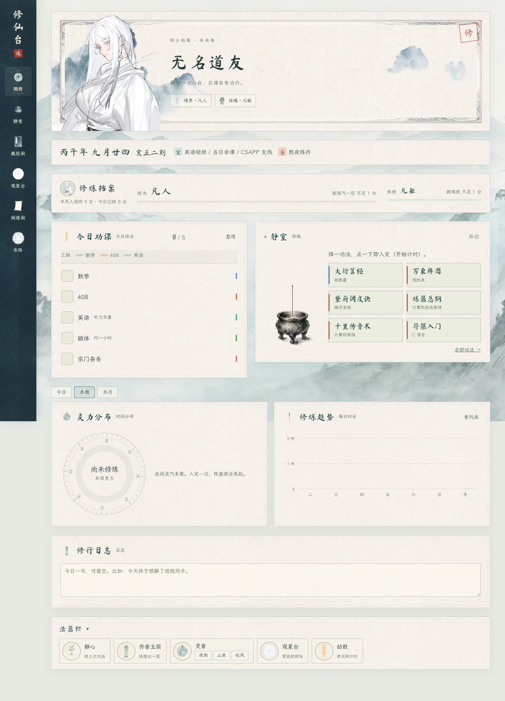
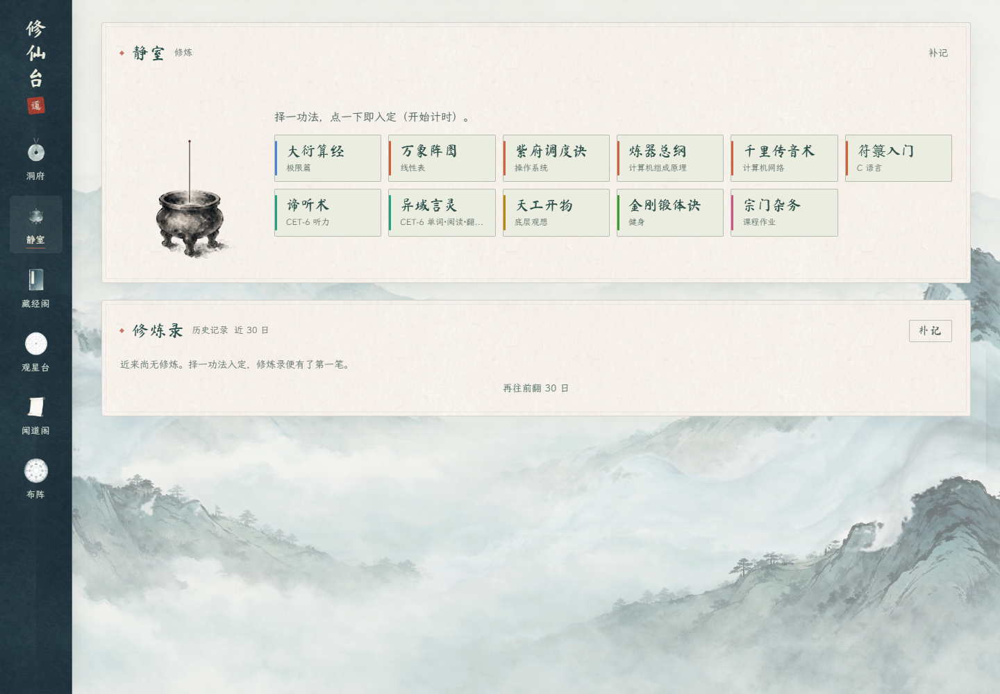
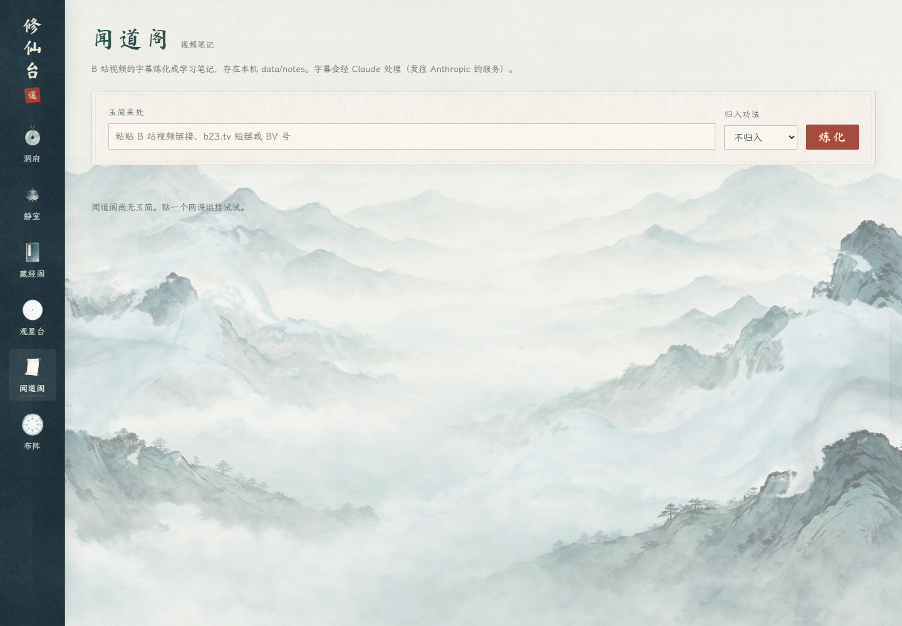

# 修仙台

修仙台是一款给自己用的本地学习工作台。它把每日功课、学习计时、修炼记录和统计放进一个修仙主题的洞府里；网课字幕还可以交给「闻道阁」整理成 Markdown 学习笔记。



## 当前阶段

项目已从概念验证进入**可日常使用的单用户 MVP**：Spring Boot 后端和 Vue 前端可以在 Windows 本机启动，学习数据保存在本地 SQLite 数据库中，主要学习闭环和配套页面已经实现。它目前面向个人自用，不包含账号体系、多用户隔离或公网部署方案；闻道阁也需要本机额外配置 B 站登录 Cookie 和 Claude Code CLI。

## 特色功能

### 今日功课与日课模板

首页按星期生成当天功课，可以直接打卡、临时添加或删除项目。设置里可维护重复日课模板，功课按所属道脉分类；修行日志是可选的，不会因为漏写而影响打卡。

### 静室计时与修炼结算

从功法列表选择一门功法即可开始计时，支持暂停、继续和结束。结束后记录本次时长并显示结算；计时会跨页面持续，页面也会定期向本机服务同步状态，因此同一私有网络中的手机和电脑能看到同一份修炼进度。香尽提示、久未操作提醒和手动补录让计时更适合日常使用。

### 功法、境界与修炼档案

在藏经阁管理功法和道脉，查看每门功法累计的修炼时长与境界进度。修炼录保存历史会话，可按日期回看；统计页以真实修炼时长展示今日、本周或本月的道脉分布和每日趋势。

### 观星台与洞府设置

观星台集中管理常用网站入口，也可以手动收藏链接并标记「想研究」「已试用」等状态。设置页还可调整个人称呼、道脉、日课模板、作息时段、倒计时和视觉/提醒偏好。

### 闻道阁：视频字幕炼化为笔记

提交 B 站视频链接后，闻道阁获取可用字幕，清洗并保留字幕文件，再调用 Claude CLI 生成带来源信息和时间点的 Markdown 笔记。任务状态和生成结果可以在页面查看，笔记保存在本机 `data/notes/`，可用 Obsidian 或 Typora 阅读。

闻道阁只处理字幕，不下载视频，也不做画面识别或语音转写。获取 B 站字幕通常需要登录 Cookie；字幕会发送给 Claude/Anthropic 处理，**不属于纯本地 AI 功能**。配置步骤和故障说明见 [闻道阁文档](docs/WENDAO.md)。

## 产品截图

以下为运行中的应用页面，使用隔离的默认数据截取，不含个人学习记录。

| 静室：选择功法、开始计时并回看修炼录 | 闻道阁：提交视频链接并管理炼化任务 |
| --- | --- |
|  |  |

## 启动

需要 **JDK 17+** 和 **Maven**。Windows 下双击 `start.bat`：首次运行会构建应用，之后直接启动，默认打开 <http://127.0.0.1:7788/>。关闭启动窗口即可停止服务。

也可以在项目根目录手动运行：

```powershell
mvn -q test
mvn -q package
java -jar target/xiuxiantai.jar
```

应用只监听 `127.0.0.1`，且没有登录功能。不要把端口转发到公网。需要手机访问时，可按下面的 Tailscale 说明连接自己的设备。

### 手机访问（Tailscale）

电脑和手机安装 Tailscale 并登录同一账号，在管理后台开启 MagicDNS 与 HTTPS Certificates。电脑启动修仙台后运行：

```text
tailscale serve --bg 7788
```

使用命令输出的 `https://<设备名>.<尾网域名>.ts.net` 地址在手机浏览器访问，也可添加到主屏幕。电脑需要保持开机且不能睡眠。停止访问可运行 `tailscale serve reset`。不要用 ngrok、cloudflared 或路由器端口转发公开无登录保护的应用。

## 闻道阁配置

闻道阁需要本机已登录的 Claude Code CLI，以及 B 站登录 Cookie：

1. 在浏览器登录 B 站，导出 Netscape 格式的 `cookies.txt`，放到 `config/bilibili-cookies.txt`。该文件等同于账号登录态，不要分享或提交。
2. 确认命令行中的 `claude` 可以运行。
3. 在闻道阁粘贴视频链接并开始炼化。

字幕、笔记、任务和日志等数据位于 `data/`；提示词位于 `prompts/bilibili_note.md`，可直接编辑。具体流程、隐私边界和限制见 [docs/WENDAO.md](docs/WENDAO.md)。

## 技术与文档

- 后端：Java 17、Spring Boot、JdbcTemplate、SQLite
- 前端：Vue 3 原生 ES modules，无需单独构建；Vue 和 Markdown 渲染器随项目本地提供
- 数据：SQLite 与本地文件；整个 `data/` 目录可用于备份
- 产品需求：[修仙台产品需求说明.md](修仙台产品需求说明.md)
- API 约定：[docs/API.md](docs/API.md)
- 闻道阁实现说明：[docs/WENDAO.md](docs/WENDAO.md)

```text
src/main/java/com/xiuxian       Spring Boot 后端
src/main/resources/static       Vue 页面、样式和本地静态资源
wendao/refine.py                字幕获取与笔记生成脚本
prompts/bilibili_note.md        笔记生成提示词
data/                           本地数据库、笔记、字幕与日志
docs/screenshots/               README 使用的产品截图
```
